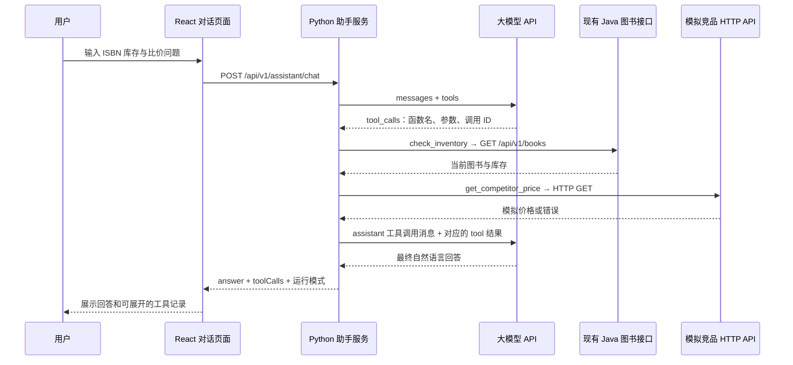

# Task 2：书店客服 AI 助手实现说明

## 1. 任务目标

本任务为 E-BookStore 增加一个客服对话入口，让用户通过自然语言查询书店库存和模拟竞争对手价格。

典型问题为：

> 帮我查一下 ISBN为12345 的书还有多少本，顺便看看别家卖多少钱。

实现的核心是 Function Calling 闭环：由大模型选择工具并生成参数，应用程序实际执行函数，把结果回传模型，再将模型生成的自然语言回答显示到前端。界面同时展示工具调用记录，便于验收。

## 2. 先核对仓库现状，再确定实现方案

开始前检查了现有 React 前端、Spring Boot 控制器、BookDto、图书服务、数据库配置及初始化脚本。

现有仓库已经提供公开的 `GET /api/v1/books`，实际响应中的 `data` 是 BookDto 数组，包含 `isbn` 和 `stock`。因此本任务复用这个接口读取库存，没有把此前设计的 OpenAPI 分页目标接口当作已经实现的接口。

最终采用以下方案：

| 部分 | 实现方式 | 选择原因 |
| --- | --- | --- |
| 对话页面 | 在已有 React 前端新增 `/assistant` 页面和菜单入口 | 复用现有页面布局和 Ant Design，不另建一套前端工程 |
| 助手服务 | 独立 Python HTTP 服务，默认端口 8001 | 满足 Python / Java 二选一要求；仅用 Python 标准库，不新增 pip 依赖 |
| 库存查询 | Python 每次调用现有 Java 后端 | 读取当次数据库接口结果，不使用静态库存冒充实时库存 |
| 竞品价格 | Python 发起 HTTP 请求访问本机模拟竞品 API | 保留外部 API 调用结构，同时明确价格为模拟数据 |
| 模型接口 | Chat Completions 兼容协议 | 与用户提供的学校模型服务对接 |

没有修改原 Java 后端的图书管理业务，也没有改变原有六项图书目标契约。

## 3. 整体调用架构



图中展示正常的一轮工具调用。模型也可以分轮调用工具；服务端在规定轮数内持续处理，直至收到最终回答。

## 4. 两个 Function 的定义与执行

核心代码位于 [server.py](server.py)。

### 4.1 check_inventory(isbn)

该函数首先校验 ISBN 参数，然后根据 `INVENTORY_MODE` 选择数据来源。

- `live`：请求现有 `http://127.0.0.1:8080/api/v1/books`，检查响应格式，查找匹配 ISBN 的图书并返回库存。
- `demo`：读取明确标注的演示夹具，便于在没有 MySQL 时检查 Function Calling。

实时模式每次重新请求后端，没有库存缓存；后端故障时不会自动改用演示库存。

实时查询结果中的 `source` 为 `bookstore_live`；演示结果为 `demo`。查不到图书时返回 `NOT_FOUND`，不会将“没有找到图书”当成“库存为零”。

仓库未规定 ISBN 唯一，因此当同一 ISBN 对应多条记录时，返回匹配记录、匹配数量及库存合计，而不是擅自拒绝重复 ISBN。

ISBN 参数使用字符串，以保留前导零。课堂演示接受 5 位编号，正式格式接受 10/13 位 ISBN，当前实现不进行 ISBN 校验位计算。

### 4.2 get_competitor_price(isbn)

该函数校验 ISBN 后，通过实际 HTTP 请求访问模拟竞品接口：

```text
GET http://127.0.0.1:8001/mock/competitor-price?isbn=12345
```

示例成功结果：

```json
{
  "ok": true,
  "isbn": "12345",
  "competitor": "模拟书店 A",
  "price": "55.90",
  "currency": "CNY",
  "simulated": true
}
```

竞品价格采用字符串金额。界面和模型提示均要求说明其为模拟报价，不将其描述为实际市场价格。

ISBN `00000` 专用于模拟超时，竞品 HTTP 接口返回 504。客户端还配置了实际请求超时时间，以便同时处理真正的连接或读取超时。

## 5. Function Schema 与模型 Tool 配置

`TOOLS` 列表定义了两个工具。以库存工具为例，其结构为：

```json
{
  "type": "function",
  "function": {
    "name": "check_inventory",
    "description": "按 ISBN 查询本书店当前库存，返回库存数量与数据来源；不存在时返回 NOT_FOUND。",
    "strict": true,
    "parameters": {
      "type": "object",
      "properties": {
        "isbn": {
          "type": "string",
          "description": "ISBN 字符串：课堂演示可用 12345 或 00000；正式数据为 10/13 位，无连字符。"
        }
      },
      "required": ["isbn"],
      "additionalProperties": false
    }
  }
}
```

`get_competitor_price` 使用相同的参数结构，具有独立的函数名和描述。

每次调用模型时传入 `messages`、`tools` 和 `tool_choice=auto`，让模型根据用户问题决定是否调用工具。函数参数的运行时校验由服务端继续执行，不能只依赖模型遵守 Schema。

学校 API 的配置为：

```text
OPENAI_BASE_URL=https://models.sjtu.edu.cn/api/v1
OPENAI_MODEL=deepseek-chat
```

密钥通过启动时的隐藏输入或服务端环境变量提供，不写入前端、源码、文档或提交包。实际联调使用的是 `deepseek-chat`；其他可配置模型没有在本任务中逐一验证。

## 6. Tool Call 的解析、派发和结果回传

模型返回的 `tool_calls` 中包含：

- `id`：关联工具请求与工具结果。
- `function.name`：需要执行的函数。
- `function.arguments`：JSON 编码的参数字符串。

`run_chat()` 验证调用结构和 ID；`execute_tool()` 解析参数 JSON，并通过固定白名单选择本地函数：

```python
FUNCTIONS = {
    'check_inventory': check_inventory,
    'get_competitor_price': get_competitor_price,
}
```

程序不执行模型生成的任意代码，不使用 `eval`。未知函数、缺失字段或额外参数都会返回结构化错误。

执行后先保留模型原始 assistant 工具调用消息，再为每个调用追加对应的结果。例如：

```json
{
  "role": "tool",
  "tool_call_id": "示例调用ID",
  "content": "{\"ok\":true,\"isbn\":\"12345\",\"source\":\"demo\",\"stock\":100}"
}
```

这里的 `content` 是工具结果的 JSON 字符串，`tool_call_id` 必须对应模型返回的实际调用 ID，不能随意替换。上述 ID 仅为说明示例。

追加工具结果后再次调用模型。若模型继续返回工具调用，则继续处理；若返回有效文本，则作为最终回答。每个问题最多进行 5 轮模型交互，每次模型请求最多输出 1200 tokens，防止异常循环持续消耗资源。

服务端以 `TOOL_CALL` 日志打印函数名、参数与结果；前端也打印到浏览器 Console，并展示可展开记录。

协议参考：[OpenAI 官方 Function Calling 文档](https://developers.openai.com/api/docs/guides/function-calling)。

## 7. 异常处理与 Self-Correction

工具错误使用统一的结构反馈模型，例如：

```json
{
  "ok": false,
  "error": {
    "code": "TIMEOUT",
    "message": "上游接口超时，可重试一次。",
    "retryable": true
  }
}
```

| 情况 | 程序处理 | 模型后续行为要求 |
| --- | --- | --- |
| ISBN 错误或参数类型错误 | 返回 INVALID_ISBN / INVALID_ARGUMENTS | 可明确恢复的参数进行纠正；无法确定则询问用户，不猜测 |
| 图书不存在 | 返回 NOT_FOUND | 说明未找到，不将库存编为 0 |
| 竞品超时 | 返回 TIMEOUT，标记可重试 | 最多重试一次，失败后说明报价暂不可用 |
| 后端不可达 | 返回 UPSTREAM_UNAVAILABLE | 说明当前无法取得库存，不降级为假库存 |
| 未配置模型密钥 | 返回可读配置错误 | 前端显示错误，不伪装成正常模型回复 |
| 未知函数或非法 JSON | 返回对应工具错误 | 模型可以按已声明的工具与参数重新生成调用 |
| 工具调用循环过长 | 返回 TOOL_LOOP_LIMIT | 结束请求，避免无限循环 |

重试上限由模型提示和服务端共同控制。当前服务端按函数名及原始参数 JSON 字符串记录超时次数；相同调用两次超时后不再实际执行，并返回 `RETRY_LIMIT`。另有 5 轮总上限。

Self-Correction 的关键是把错误放入模型上下文，让模型看到具体错误并做下一步决策，而不是仅在应用中显示异常后直接终止。

## 8. React 对话界面

前端实现位于 [AssistantPage.js](../frontend/src/pages/AssistantPage.js)，样式位于 [AssistantPage.css](../frontend/src/pages/AssistantPage.css)。在 App.js 注册 `/assistant` 路由，在 Layout.js 添加“智能助手”菜单。

页面包含问题输入框、四种示例问题、用户与助手对话、等待状态、错误提示、运行模式提示以及工具调用详情。支持 Enter 发送、Shift+Enter 换行，并避免中文输入法组合输入误触发发送。

前端只提交已完成的 user / assistant 文本对话，不接收用户注入的 system 或 tool 消息。单次处理中的工具消息由服务端维护。

助手成功响应包含 `answer`、`toolCalls`、`mode` 与 `inventoryMode`，前端据此显示自然语言回答并明确标注数据来源。

## 9. 开发中发现并修复的问题

### 9.1 健康检查误报连接失败

用户实际页面曾同时出现“助手服务尚未连接”和成功的模型回答，而后台 `/health`、工具调用及聊天请求均成功。

排查代码后发现：React StrictMode 开发检查会清理首次 effect，取消其健康检查请求；旧代码把这种取消也当成连接失败，而且成功后没有清空旧错误。

修复方式：

1. 使用 effect 的有效标记，忽略清理或卸载后的异步结果。
2. 健康检查或聊天成功时清除旧错误。
3. 用连接状态版本号，防止迟到的健康检查失败覆盖更新的成功状态。

为三个场景补充了回归测试，均已通过。

### 9.2 数据库 ISBN 带连字符导致匹配失败

仓库初始化数据使用带连字符的 ISBN，例如《三体（全集）》为 `978-7-229-03026-9`，而模型工具参数采用紧凑形式。

因此在数据库查询结果的比较阶段去除 ISBN 中的连字符和空白，并统一大写。不修改数据库原值，也不把不同图书合并成新的业务实体。补充了针对带连字符 ISBN 的测试。

### 9.3 区分三种运行组合

| 模型模式 | 库存模式 | 用途 |
| --- | --- | --- |
| live | live | 真实模型 + 当前书店后端库存 |
| live | demo | 真实模型 + 演示库存，便于展示 Function Calling |
| demo | demo | 完全离线协议演示，不作为真实模型调用证据 |

模拟竞品价格在以上组合中始终是模拟数据。`mode=live` 仅表示使用真实模型适配器，不自动表示库存也来自真实数据库。

## 10. 实际验证结果与边界

### 10.1 自动测试

| 检查 | 实际结果 |
| --- | --- |
| Python 单元及本机 HTTP 集成测试 | 最后一次执行 22 项全部通过 |
| React 助手页面测试 | 最后一次执行 7 项全部通过 |
| JSX 语法检查 | 开发期间所检查的四个 JS 文件通过 |
| 生产构建 | 开发期间曾成功；连接状态和 ISBN 修复后未再次执行生产构建 |
| git diff --check | 最后一次代码修复后通过 |

Python HTTP 测试替身覆盖前端请求格式、模型 API 适配器、工具执行和结果回传的完整协议。测试替身不是实际外部大模型，需要与下面的真实调用证据分开看待。

### 10.2 真实模型联调

| 场景 | 实际行为 | 证据 |
| --- | --- | --- |
| 查询 12345 的库存和价格 | 真实模型返回两个工具调用，收到结果后回复演示库存 100 本、模拟价 55.90 元 | [live-normal.json](live-normal.json) |
| 查询错误 ISBN abc | 模型在调用工具前直接识别错误并要求提供正确 ISBN，实际工具调用为 0 次 | [live-invalid.json](live-invalid.json) |
| 查询 00000，模拟竞品超时 | 库存工具成功；竞品调用两次均超时；模型最终说明暂不可用，共 3 次工具调用 | [live-timeout.json](live-timeout.json) |

错误 ISBN 的真实联调不能被描述成“模型已收到工具错误后纠正”。工具错误回传后修正参数的闭环由 CorrectingModel 测试替身验证；真实模型的异常反馈闭环由竞品超时重试场景展示。

上述真实模型证据均使用演示库存。实时库存适配器已实现并通过本机 HTTP 测试，但真实 MySQL / Java / 模型的完整链路仍需用户完成数据库认证后验收，不能声称该项已完成。

更完整的执行范围记录见 [VALIDATION.md](VALIDATION.md)。

## 11. 运行与验收方式

从原工程根目录运行真实模型与演示库存：

```bash
INVENTORY_MODE=demo python3 scripts/run_assistant_live.py
```

启动时输入模型 API key，输入不回显、不保存。另开终端启动现有前端：

```bash
cd frontend
npm start
```

打开 `http://localhost:3000/assistant`，发送示例问题并展开工具调用记录。

检查真实库存时，先按原工程要求启动 MySQL 与 Java 后端，确认 `http://localhost:8080/api/v1/books` 返回数组，再停止旧助手并改用：

```bash
INVENTORY_MODE=live python3 scripts/run_assistant_live.py
```

可查询 `9787229030269` 对应的《三体（全集）》，并核对工具结果 `source=bookstore_live` 与数据库当前库存一致。初始化库存为 60，实际值以当前数据库为准。

自动检查命令：

```bash
sh scripts/test_assistant.sh
```

Python 只使用标准库。前端依赖由用户自行安装，测试和启动脚本不执行安装。学校模型接口每分钟最多 10 次请求，一个问题会产生多次模型请求，应避免快速并发演示。

## 12. 评分项对应与提交内容

| 评分项 | 对应实现与可检查内容 |
| --- | --- |
| A：符合要求的 Function Schema | TOOLS：两个工具的描述、参数类型、必填限制与额外字段限制 |
| B：解析 Tool Call | run_chat / execute_tool：解析 id、name、arguments，并打印日志 |
| C：本地模拟执行 | 演示库存夹具、实际 HTTP 调用的模拟竞品接口 |
| D：结果回传模型并生成回答 | assistant 工具请求消息 + role=tool / tool_call_id 结果消息 + 最终 answer |
| E：异常与 Self-Correction | 参数错误反馈、纠正参数测试、真实超时重试证据及结束机制 |

提交包通过固定文件白名单生成，只收录本次新增或修改的源码、运行与测试脚本、说明文档、调用证据和 SHA-256 文件清单。前端集成文件需覆盖到原工程相应目录，其他工程文件由原 E-BookStore 提供。

重新打包命令：

```bash
python3 scripts/package_assistant_submission.py
```

生成文件为 `submission/ebookstore-assistant-submission.zip`。打包脚本检查 ZIP 完整性，并排除整个工程、node_modules、build、target、第三方 JAR、.env、.git、缓存及疑似真实 API key。

最终由用户将 ZIP 上传至课程作业平台。如另外提交截图或录像，应展示正常查询、错误 ISBN、模拟超时三个场景及展开的工具记录。
