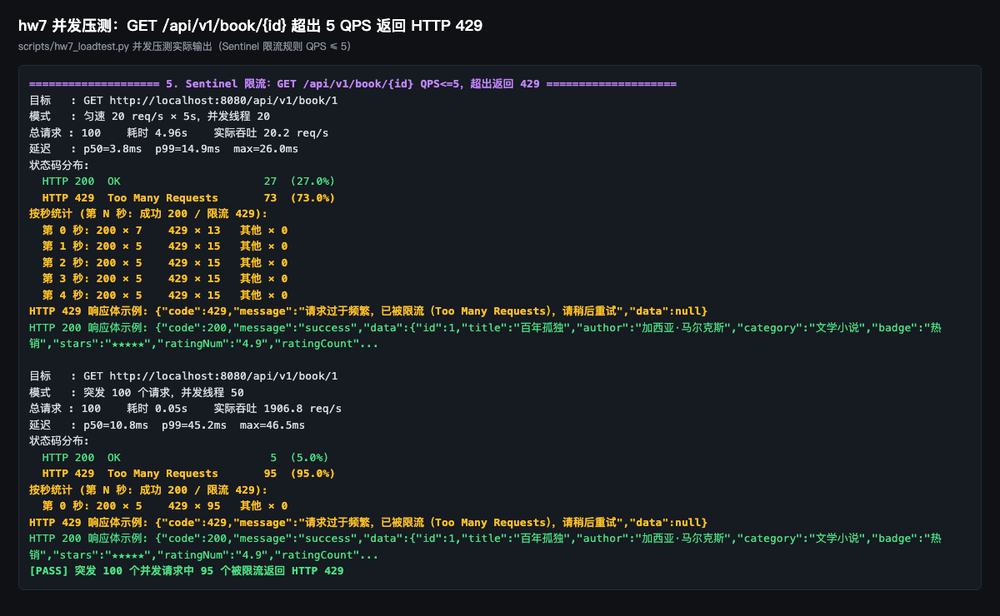

# 作业 7：Redis 缓存治理 + Sentinel 限流熔断

## 1. 需求与实现对照

| 评分项 | 实现 |
| --- | --- |
| [1] 集成 Redis，读写缓存分离（Cache-Aside） | `spring-boot-starter-data-redis`；`cache/BookCache`：**读**先查 Redis，未命中查库并回写（TTL 30min + 0~5min 随机抖动）；**写**（`BookServiceImpl#create/update/delete`、下单扣库存 `OrderServiceImpl`）先写库，**事务提交后删除缓存** |
| [1] 防穿透 / 防击穿底层代码 | **防穿透**：库中不存在的 id 缓存空对象 `__NULL__`（TTL 120s），非法 id（≤0）直接 404。**防击穿**：`SET lockKey token NX EX 10` 互斥锁，只有抢到锁的线程查库重建；其他线程每 50ms 重读缓存；双重检查；Lua 脚本比较 token 后释放锁 |
| [1] 引入治理组件 | Spring Cloud Alibaba Sentinel（`spring-cloud-starter-alibaba-sentinel 2023.0.1.0`，Sentinel 1.8.6） |
| [1] 针对接口配置限流 / 熔断规则 | `governance/SentinelRuleConfig`：资源 `/api/v1/book/{id}` **QPS ≤ 5**，超出快速失败；资源 `bookDetailQuery`（`@SentinelResource`）**异常比例 > 50% 熔断 10s**。超限由 `governance/SentinelBlockHandler` 返回 **HTTP 429** / 熔断返回 503 + 降级信息 |
| [1] 并发压测触发 429 截图 | `scripts/hw7_loadtest.py`（并发压测工具）+ `jmeter/hw7-book-detail-ratelimit.jmx`（JMeter 测试计划）；截图见 `hw7-evidence/ratelimit-429.png` |

## 2. 请求链路

```
GET /api/v1/book/{id}
   │
   ├─ SentinelWebInterceptor ── 资源 "/api/v1/book/{id}"，QPS > 5 ──▶ SentinelBlockHandler → 429 Too Many Requests
   │
   ▼
BookController#getOne → BookServiceImpl#getById  (@SentinelResource "bookDetailQuery"，异常比例过高 → 熔断 → 503 降级信息)
   │
   ▼
BookCache#getOrLoad
   ① GET bookstore:book:detail:{id}
        ├─ 命中 JSON        → 返回
        ├─ 命中 "__NULL__"  → 404（防穿透，不查库）
        └─ 未命中 ↓
   ② SET bookstore:lock:book:{id} <uuid> NX EX 10
        ├─ 抢到锁 → 再查一次缓存（双重检查）→ 查 MySQL → SET 结果/空对象 → Lua 释放锁
        └─ 没抢到 → sleep 50ms → 重读缓存（最多 60 次，超时返回 503 “系统繁忙”）
   ③ Redis 故障 → 降级直接查库（缓存不可用不影响业务，数据库仍受 Sentinel 限流保护）

写路径（管理员增删改图书 / 下单扣库存）：
   UPDATE MySQL ──(事务 afterCommit)──▶ DEL bookstore:book:detail:{id}   （下一次读时重建）
```

设计要点：
- **先写库再删缓存，并在事务提交后删除**：避免事务未提交时其他线程读到旧数据又回填进缓存。
- `getById` 使用 `Propagation.NOT_SUPPORTED`：等锁的线程不持有数据库连接，防止秒杀时连接池被占满。
- 新增图书时也会删除该 id 的缓存，防止此前缓存的空对象让新书“查不到”。
- 熔断规则 `exceptionsToIgnore = BusinessException`：404 等业务异常不计入失败，只有数据库/系统异常才会触发熔断。

## 3. 新增 / 修改的文件

```
backend/
├── pom.xml                                         # + spring-boot-starter-data-redis, spring-cloud-starter-alibaba-sentinel
├── src/main/resources/application.properties       # + Redis 连接 / 缓存 TTL / 锁参数 / Sentinel 规则阈值
├── src/main/java/com/bookstore/
│   ├── cache/BookCache.java                        # 新增：Cache-Aside + 空对象 + SETNX 互斥锁 + TTL 抖动
│   ├── governance/SentinelRuleConfig.java          # 新增：限流规则(QPS≤5) + 熔断规则
│   ├── governance/SentinelBlockHandler.java        # 新增：限流 → 429，熔断 → 503
│   ├── service/impl/BookServiceImpl.java           # 修改：详情走缓存、@SentinelResource、写后删缓存
│   ├── service/impl/OrderServiceImpl.java          # 修改：扣库存后删除对应图书缓存
│   └── controller/BookController.java              # 修改：+ 管理员查看/清零缓存统计接口
├── src/test/java/com/bookstore/
│   ├── cache/BookCacheRedisTest.java               # 新增：真实 Redis 下验证 Cache-Aside / 防穿透 / 100 线程防击穿
│   └── service/impl/{Book,Order}ServiceImplTest    # 修改：适配 BookCache
├── redis/docker-compose.yml                        # 本地 Redis
├── jmeter/hw7-book-detail-ratelimit.jmx            # JMeter 压测计划：50 线程 × 4 次
├── scripts/hw7_loadtest.py                         # 并发压测工具（统计状态码 / 每秒 200 与 429 数量）
├── scripts/hw7_verify.sh                           # 一键验证
├── scripts/hw7_render_evidence.py                  # 把验证输出渲染成截图
└── hw7-evidence/                                   # 验证输出与截图
```

## 4. 运行与验证

```bash
# 1) 启动 Redis（任选其一）
brew install redis && brew services start redis
# docker compose -f redis/docker-compose.yml up -d

# 2) 启动后端（MySQL 照旧；Kafka 未启动不影响本作业）
mvn -DskipTests package && java -jar target/bookstore-backend-0.0.1-SNAPSHOT.jar

# 3) 单元测试（含真实 Redis 的防击穿并发测试）
mvn test

# 4) 一键验证 + 截图
./scripts/hw7_verify.sh
python3 scripts/hw7_render_evidence.py

# 5) 也可用 JMeter：GUI 打开 jmeter/hw7-book-detail-ratelimit.jmx 运行，在“汇总报告/察看结果树”中可见 429
jmeter -n -t jmeter/hw7-book-detail-ratelimit.jmx -l hw7-evidence/jmeter.jtl -e -o hw7-evidence/jmeter-report
```

可调参数（`application.properties`）：

| 配置 | 默认 | 含义 |
| --- | --- | --- |
| `bookstore.sentinel.book-detail.qps` | 5 | 详情接口每秒允许的请求数 |
| `bookstore.sentinel.book-detail.degrade.*` | 0.5 / 5 / 10000ms / 10s | 熔断：异常比例 / 最小请求数 / 统计窗口 / 熔断时长 |
| `bookstore.cache.book.ttl-seconds` / `ttl-jitter-seconds` | 1800 / 300 | 缓存 TTL 与随机抖动 |
| `bookstore.cache.book.null-ttl-seconds` | 120 | 空对象 TTL |
| `bookstore.cache.book.lock-*` | 10s / 50ms / 60 次 | 互斥锁过期时间、重试间隔、重试次数 |

## 5. 验证结果

以下数据来自 `scripts/hw7_verify.sh` 的实际输出（完整内容见 `hw7-evidence/verify-output.txt`）。

| 用例 | 结果 |
| --- | --- |
| Cache-Aside 读 | 清空 key 后连续两次请求：`dbLoads=1, hits=1`；Redis 中写入 JSON，TTL 1931s（1800 + 随机抖动） |
| 防穿透 | 不存在的 id 999999 请求 3 次：只查库 1 次，Redis 写入 `__NULL__`（TTL 119s），后 2 次 `nullHits=2` |
| 写后删缓存 | 管理员 `PUT /api/v1/admin/books/1` 后 `EXISTS bookstore:book:detail:1` 由 1 → 0 |
| 防击穿 | `BookCacheRedisTest`：100 线程并发访问冷 key（模拟 300ms 慢查询），**查库 1 次**，99 个线程等锁后命中缓存 |
| 限流（匀速 20 req/s × 5s） | 200 × 27 / **429 × 73**，第 1~4 秒每秒恰好放行 5 个 |
| 限流（突发 100 并发） | 200 × 5 / **429 × 95**，响应体 `{"code":429,"message":"请求过于频繁，已被限流（Too Many Requests），请稍后重试"}` |
| 对照 | 无规则的 `GET /api/v1/books` 30 个并发请求全部 200 |

截图：

- `hw7-evidence/ratelimit-429.png`：并发压测触发 HTTP 429
- `hw7-evidence/cache-redis.png`：缓存读写 / 防穿透 / 防击穿
- `hw7-evidence/verify-report.png`：全部用例


