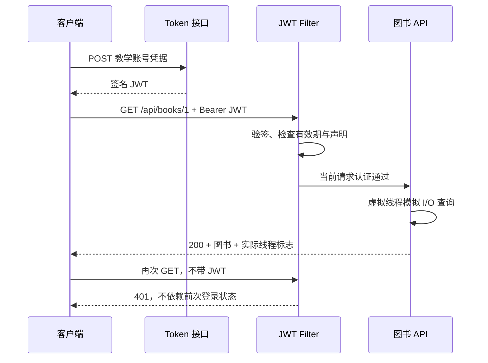

# Task 4 实现说明：Spring Boot 虚拟线程与 JWT 无状态认证

## 1. 实现范围与技术选择

为本次作业创建独立的 `cloud-backend` Spring Boot Web 模块，默认端口 8081。它提供受 JWT 保护的图书查询，使用 Thread.sleep 模拟数据库 I/O，不依赖 MySQL，不改变原有书店及 Task 2/3 的服务。

沿用仓库已有的 Spring Boot 3.2.5 和 JJWT 0.12.5，以复用已缓存依赖。源码编译目标为 Java 21；根据用户确认，本次实际运行和测试使用现有 Java 24.0.1。Java 24 支持虚拟线程，不能将本次结果描述成“实际在 Java 21 上运行”。

## 2. RESTful API

| 方法与路径 | 用途 | 主要状态码 |
| --- | --- | --- |
| POST /api/auth/token | 校验教学账号凭据并生成 JWT | 200 / 400 / 401 |
| GET /api/books/{id} | 按资源 ID 查询图书 | 200 / 400 / 401 / 404 |

成功响应为 `{code,message,data}`。图书包含 id、title、author、category、price、stock，price 为字符串。错误响应 data 为 null，code 与 HTTP 状态一致。

图书目录使用不可变 Map 与 record，明确为课堂模拟数据。GET 查询不修改资源，ID 小于 1 或格式错误返回 400，不存在返回 404；无效认证在控制器前返回 401。

## 3. 虚拟线程的开启与实际使用

配置：

```properties
spring.threads.virtual.enabled=true
spring.main.keep-alive=true
```

服务为 Spring MVC + 嵌入式 Tomcat。使用 Spring Boot 的虚拟线程请求处理支持，而不是把控制器中的一小段逻辑另交给虚拟线程后就声称整个 Web 请求已改造。

`BookCatalog.find()` 中执行：

```java
Thread.sleep(delayMs);
```

默认模拟 200ms 阻塞查询，不在 synchronized 块中持有锁，避免用共享锁把请求串行化。虚拟线程可以在这类等待期间让出底层载体线程，但不会把单次 200ms I/O 本身变快。

`RequestThreadFilter` 在真实请求执行线程上读取：

```java
Thread.currentThread().isVirtual()
Thread.currentThread().getName()
```

并通过响应头给出证据：

```text
X-Request-Thread-Virtual
X-Request-Thread-Name
X-Java-Version
```

测试验证开启时为 true，关闭时为 false。平台线程对照组设置最多 20 个 Tomcat 工作线程，该参数不作为虚拟线程的工作线程池上限。

## 4. JWT 的生成和校验

### 生成

AuthController 使用 Bean Validation 校验登录 JSON，使用 BCrypt 检查演示账号密码。认证成功后由 JwtService 生成签名 JWT，包括：

- subject：用户名。
- issuer：ebookstore-cloud。
- role：USER。
- issuedAt：签发时间。
- expiration：过期时间，默认一小时。

签名算法使用 HS256。密钥由环境配置；启动脚本在未配置时生成临时随机密钥，既不打印也不写入文件。Token 响应设置 Cache-Control: no-store。

### 校验

JwtAuthenticationFilter 从 Authorization 请求头提取 Bearer Token，通过 JJWT 校验签名、有效期和发行方，并要求 subject、expiration、role 等声明有效。

合法 Token 仅为当前请求创建 SecurityContext；缺失 Token 由 SecurityFilterChain 的认证入口返回 401。格式错误、签名篡改、过期、错误发行方或必要声明缺失均返回 JSON 401。

过滤器只挂载进 SecurityFilterChain，没有同时作为 Servlet Filter 自动注册，避免重复执行和顺序混乱。

## 5. 无状态设计

关键配置：

```java
.sessionManagement(s -> s.sessionCreationPolicy(SessionCreationPolicy.STATELESS))
.securityContext(s -> s.securityContextRepository(new NullSecurityContextRepository()))
.requestCache(AbstractHttpConfigurer::disable)
.formLogin(AbstractHttpConfigurer::disable)
.httpBasic(AbstractHttpConfigurer::disable)
.logout(AbstractHttpConfigurer::disable)
```

不使用 HttpSession 保存登录状态，不通过 JSESSIONID 认证，也不将 SecurityContext 保存到 Session。每次访问图书资源都必须重新携带 JWT。



无状态针对客户端会话，不是禁止存储业务数据。此模块使用不可变模拟目录；未来可以替换数据库查询。多实例部署若需要相互接受 Token，需共享稳定的签名配置；临时随机密钥只用于本机教学启动。

## 6. 实际验证

### 自动测试

JUnit 直接启动随机端口的真实 Tomcat，通过 Java HttpClient 发起 HTTP 请求，没有 MockMvc 或 mock 请求线程。

23 项测试全部通过，覆盖无 Token、错误 Token、空 Bearer、Basic 头、合法认证、大小写不敏感的 Bearer 方案、篡改、过期、发行方、必要声明、登录错误、非法 ID、404、Cookie 不能认证以及每次请求独立认证。

40 个并发请求均成功并报告虚拟线程为 true；另一项对照测试关闭虚拟线程，实际请求报告 false。测试响应没有 Set-Cookie。

### HTTP 验收报告

verify_api.py 自动登录，JWT 仅保留在内存，随后执行七项实际 HTTP 验收。结果保存为 JSON 和可截图的 HTML，不保存 Token、登录密码或签名密钥。

截图不能用手工填入的“预期状态”冒充实际执行。本报告中的 status 和响应头来自实际请求；用户在浏览器打开报告后拍摄真实截图提交。

### 并发 I/O 对照

两组都使用同一代码、默认 200ms 模拟 I/O，预热 5 次，各执行 100 次请求、并发客户端数 50。虚拟线程组开启虚拟线程；平台线程组限制 20 个工作线程。

本机 Java 24.0.1 实测：

| 指标 | 虚拟线程 | 平台线程对照 |
| --- | --- | --- |
| 成功请求 | 100/100 | 100/100 |
| 总耗时 | 0.5222 秒 | 1.1092 秒 |
| 吞吐 | 191.5 请求/秒 | 90.16 请求/秒 |
| 平均延迟 | 236.46ms | 456.53ms |
| P95 延迟 | 256.06ms | 642.47ms |
| 实际请求线程标志 | true | false |

这次实验吞吐比约 2.124，不是对任意生产场景的性能保证。对照组有明确的平台线程数限制，CPU、连接池、网络与客户端资源也会影响结果；不据此宣称已经“压榨到硬件极限”。

## 7. 主要文件

| 文件 | 职责 |
| --- | --- |
| CloudApplication.java / pom.xml | Spring Boot Web 启动及 Java 21 编译目标 |
| BookCatalog.java / BookController.java | 不可变模拟目录、慢 I/O、REST 查询 |
| JwtService.java | JJWT 签发与验签 |
| AuthController.java | 凭据认证并生成 Token |
| JwtAuthenticationFilter.java | Bearer 请求认证 |
| SecurityConfig.java | 无状态安全链与统一 401/403 |
| RequestThreadFilter.java | 实际 Web 请求线程证据 |
| CloudApiTest.java / PlatformThreadControlTest.java | 真实 HTTP 与线程对照测试 |
| scripts/start.py | 无依赖下载的启动脚本 |
| scripts/verify_api.py | HTTP 验收和截图报告 |
| scripts/benchmark.py | 可复现的合成 I/O 对照 |
| scripts/test.sh / summarize_tests.py | 离线测试与脱敏摘要 |

## 8. 作业评分项对应

| 评分项 | 实现 / 证据 |
| --- | --- |
| RESTful API | GET /api/books/{id}，JSON 与 400/401/404 状态区分 |
| 虚拟线程 | Spring Boot 配置、真实线程 isVirtual 响应头、并发与平台线程对照 |
| JWT 库与生成 | JJWT、AuthController 与 JwtService |
| 无状态过滤器 | JWT Filter、STATELESS、NullSecurityContextRepository、Cookie/跨请求测试 |
| 401/200 截图 | 用户实际截图已保存为 evidence/auth-401-200.png，并与真实 HTTP 报告一并打包 |

截图来自用户实际提供的验收页面，清晰展示 401、200、X-Request-Thread-Virtual=true 与 Java 24.0.1。已保存 `evidence/auth-401-200.png`，并使用 `--require-screenshot` 重新打包；没有用生成的图示冒充截图。

## 9. 参考依据

- [Spring Boot 3.2.5 虚拟线程文档](https://docs.spring.io/spring-boot/docs/3.2.5/reference/html/features.html#features.spring-application.virtual-threads)：Java 21 或以上启用虚拟线程的配置。
- [JJWT 0.12.5 官方源码与文档](https://github.com/jwtk/jjwt/tree/0.12.5)：签名、verifyWith 和 parseSignedClaims。

实际执行记录见 VALIDATION.md，自行启动与截图步骤见 README.md。

## 10. 与其他任务的关系

四项任务的能力递进、当前真实调用关系与提交清单见 [Task 1–4 总结](../docs/TASKS_1_TO_4_OVERVIEW.md)。Task 4 是独立的 JWT / 虚拟线程模块，不表示 Task 1 的全部接口已实现，也未自动替换 Task 2/3 的数据源。
