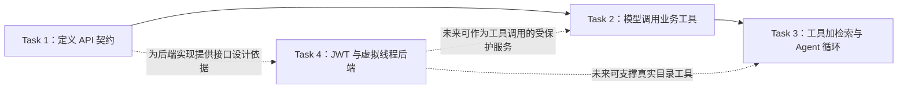

# Task 1–4 总结、相互关系与提交清单

## 1. 当前打包输出代表什么

```text
PASS ZIP integrity, SHA-256, exclusions and credential-pattern checks
Screenshot: included
```

这表示打包脚本已生成 ZIP，压缩包完整性和文件哈希检查通过，排除规则生效，并且已经包含用户提供的 401/200 PNG 截图。credential-pattern 检查是常见密钥与 JWT 字符串的模式检查，不代表对所有可能敏感内容进行了完整审计。

当前 Task 4 的提交文件是：

```text
submission/ebookstore-java21-jwt-submission.zip
```

它是本次自编源码、配置、脚本、文档、测试与证据的集合，不是整个 Web 工程，也不包含第三方 JAR。

## 2. 四项任务分别做了什么

| 任务 | 解决的问题 | 核心实现 | 主要产物 |
| --- | --- | --- | --- |
| Task 1：OpenAPI 契约 | 客户端和服务端如何约定图书接口 | OpenAPI 3.0.3 JSON、六项操作、字段与分页约束、JWT 权限、统一响应及示例 | round2.json；docs/openapi.json |
| Task 2：Function Calling 客服 | 模型如何查询库存和模拟竞品价格 | 两个函数 Schema、Tool Call 解析、实际执行、工具结果回传、自然语言回复 | assistant/、/assistant 页面 |
| Task 3：RAG + ReAct 导购 | 如何处理模糊荐书需求并有依据地回答政策 | 政策分块与向量化、模拟目录、政策检索、逐步决策与行动循环、引用与日志 | guide/、/guide 页面 |
| Task 4：虚拟线程与 JWT | 如何用无状态认证保护 API，并支持大量阻塞 I/O 请求 | Spring Boot、JWT 签发与过滤器、真实 Web 虚拟线程、认证与并发验证 | cloud-backend/、401/200 截图 |

### Task 1：先定义接口契约

定义固定六项操作：

| 方法与路径 | operationId |
| --- | --- |
| GET /api/v1/books | listBooks |
| GET /api/v1/books/{id} | getBook |
| POST /api/v1/books | createBook |
| PUT /api/v1/books/{id} | replaceBook |
| DELETE /api/v1/books/{id} | deleteBook |
| PUT /api/v1/books/{id}/stock | setBookStock |

文档明确 page/size、分类与关键词过滤、id 范围、金额字符串、stock 数值范围、完整替换及绝对库存设置语义，以及成功和错误响应。GET 公开，写操作要求 JWT 和 ROLE_ADMIN。

这是目标设计文档，没有据此修改原后端实现。仓库已有接口的路径、分页能力和返回行为与目标契约存在差异，文档已作说明。不能把 Swagger 可导入等同于六项接口都已实现。

已执行 JSON、本地引用、操作和示例相关检查。本次整理时又使用已存在的 OpenAPI 3.0 规范校验器实际检查 docs/openapi.json 与 round2.json，均通过。没有为此新增安装依赖。

round2.json 是第二轮版本，主要将重复的 id 参数复用为 components.parameters.BookId；提交 Task 1 时使用它的内容，提交包中命名为 openapi.json。

### Task 2：让模型调用明确的业务函数

定义：

```text
check_inventory(isbn)
get_competitor_price(isbn)
```

库存工具可以实时读取原 Java 后端的图书数组，也可显式使用演示数据。竞品工具通过实际 HTTP 请求查询本机模拟竞品 API，始终说明价格为模拟内容。

模型根据用户问题返回 tool_calls；服务端解析函数名、JSON 参数和调用 ID，白名单执行函数，将结果以 role=tool、tool_call_id 回传，再让模型生成最终回答。前端展示回答和工具记录。

处理了错误 ISBN、未知工具、非法参数、后端断连、模拟超时、重试和调用轮数上限。还修复了 React StrictMode 健康检查取消误报，以及数据库 ISBN 连字符导致无法匹配的问题。

已保存真实 deepseek-chat 模型的正常查询、无效 ISBN 提示和超时重试证据。其中库存使用 demo 夹具，不能将这组证据称为真实 MySQL 库存端到端验收。实时库存适配器已通过本机 HTTP 测试，真实数据库验收需要正确启动本机 MySQL / Java 后端。

### Task 3：让模型检索资料并逐步完成复合需求

定义另外两个工具：

```text
search_book_catalog(query)
query_store_policy(query)
```

准备了八章课程模拟退换货与会员政策。按章节和窗口切分，以中文单字/双字及英文词项构建 TF-IDF 向量，L2 归一化后使用余弦相似度取相关片段。当前产物为 8 个片段、1045 维向量。

这是本地词项向量 Embedding，不是神经语义 Embedding API。模拟目录也明确为教学数据，不是真实库存。

Agent 每轮输出一个 JSON 决策：thought、action、action_input。应用执行动作，记录实际 Observation 并回传模型，继续循环直至 finish。Thought 是一句公开的行动理由，不是模型内部隐藏思维链。

复杂案例实际由真实模型完成：

```text
微服务荐书 + 拆封后不喜欢能否退货
→ search_book_catalog
→ query_store_policy
→ finish：推荐模拟图书，并引用 [P02-01]、[P01-01] 回答政策
```

代码还处理引用缺失或伪造、格式错误、重复动作、无相关结果和最大轮数，避免无限循环或无依据补充政策。

### Task 4：验证一个无状态、高并发 I/O 的后端模块

构建独立 Spring Boot 模块：

```text
POST /api/auth/token
GET /api/books/{id}
```

登录后用 JJWT 签发 HS256 JWT；过滤器在每个请求校验签名、有效期、发行方和必要声明，认证失败返回 401。安全链使用 STATELESS、NullSecurityContextRepository，禁用请求缓存、表单登录和 Basic 认证，不通过 Session Cookie 维持登录。

配置 spring.threads.virtual.enabled=true。查询中 Thread.sleep 模拟慢数据库 I/O，通过实际请求线程的 Thread.currentThread().isVirtual() 返回响应头证据，不是只把一段异步代码放到虚拟线程中。

用户已明确同意使用现有 Java 24。代码编译目标保留 Java 21，实际测试运行 Java 24.0.1；两者如实区分，没有声称实际运行过 JDK 21。

无 Token 返回 401，有效 JWT 返回 200，截图同时展示 virtual=true 和实际 Java 版本。用户实际截图已加入提交包。

## 3. 四项任务的联系

### 学习与架构上的递进



- Task 1 规定接口的输入输出和业务语义，是接口协作的基础。
- Task 2 解决模型与外部程序之间的调用协议：模型提出调用，程序执行，结果回到模型。
- Task 3 在工具能力基础上增加知识检索与反复决策，使复杂问题不必一次性回答。RAG 解决“依据从哪里来”，ReAct 解决“下一步做什么”。
- Task 4 演示工具背后的服务如何使用逐请求认证和虚拟线程处理阻塞等待，为后续独立部署提供基础。

这些是能力上的联系，不代表四项已被完整接成一个生产系统。图中通往 Task 4 的虚线表示后续集成方向。

### 当前代码实际连接关系

```mermaid
flowchart TD
    F[原 React 前端] --> P2[/assistant 页面]
    F --> P3[/guide 页面]
    P2 --> A2[Python Task 2：8001]
    A2 -->|live 库存模式| B[原 Java 后端：8080]
    A2 --> C[本机模拟竞品 API]
    P3 --> A3[Python Task 3：8002]
    A3 --> D[本地模拟目录]
    A3 --> R[本地政策向量检索]
    X[验收脚本 / curl] --> A4[Task 4 Spring Boot：8081]
    A4 --> J[JWT 校验 + 虚拟线程 + 模拟图书目录]
```

尤其要区分以下几点：

1. Task 2 的实时库存目前调用原后端公开的 GET /api/v1/books，并未自动切换到 Task 4 的受保护接口。
2. Task 3 使用本地模拟目录和政策，不是调用 Task 2 的两个函数，也没有接入真实数据库目录。
3. Task 4 是独立模块，不等于原后端已经实现 Task 1 的全部创建、替换、删除和库存操作。
4. Task 1 的目标地址是 8080，Task 4 使用 8081，路径也分别为 /api/v1/books/... 与 /api/books/...。
5. 原书店登录与 Task 4 演示登录使用各自的签名配置；JWT 不能默认跨服务通用。后续接入时需要统一签发方、密钥配置、权限、路径与响应映射。

## 4. 已执行验证汇总

| 任务 | 已有实际验证 | 需要正确理解的范围 |
| --- | --- | --- |
| Task 1 | JSON、引用、约束及示例检查；本次补跑两个 JSON 的 OpenAPI 3.0 正式规范校验均通过 | 验证的是目标契约，不是后端六项功能已上线 |
| Task 2 | 22 项 Python 测试、7 项页面测试；真实模型正常与超时案例 | 保存的模型联调证据使用 demo 库存 |
| Task 3 | 25 项 Python 测试、5 项导购页面测试；与 Task 2 合计 12 项页面回归；构建通过；真实模型三步案例 | TF-IDF 词项检索，书目与政策均为模拟 |
| Task 4 | 23 项真实 Tomcat HTTP 测试、7 项实际 HTTP 验收、401/200 用户截图、并发对照 | 运行 Java 24；200ms 模拟 I/O，不是实际数据库压测 |

Task 4 本机对照中，100 请求、50 并发、20 平台工作线程限制下，虚拟线程约 191.5 请求/秒、平台线程约 90.16 请求/秒。这是固定实验条件下的观察，不能当成任意生产环境的性能保证。

## 5. 到底提交什么

### 仅提交当前 Task 4

上传：

```text
submission/ebookstore-java21-jwt-submission.zip
```

包内已经包含：Java 源码、Maven 配置、启动/验收/压测/打包脚本、README、Task 4 实现 MD、实际结果、401/200 PNG、文件哈希清单，以及本篇四任务总结。

Task 4 的详细 MD：

```text
cloud-backend/IMPLEMENTATION.md
```

不需要再压缩整个 Web，也不需要单独上传 target 或任何 JAR。若平台另设“报告”上传栏，可以额外上传这份 MD 或本篇总结。

### 四项任务分别提交

| 作业 | 推荐提交文件 | 说明文档位置 |
| --- | --- | --- |
| Task 1 | submission/ebookstore-task1-submission.zip | 包内 README 与 openapi.json；JSON 内容取第二轮 round2.json |
| Task 2 | submission/ebookstore-assistant-submission.zip | assistant/TASK2_IMPLEMENTATION.md |
| Task 3 | submission/ebookstore-task3-submission.zip | guide/TASK3_IMPLEMENTATION.md |
| Task 4 | submission/ebookstore-java21-jwt-submission.zip | cloud-backend/IMPLEMENTATION.md |

各 ZIP 为独立提交产物。Task 2/3 是原书店上的增量代码，按其 README 在原工程解压集成；Task 4 是可单独构建的最小后端模块。Task 1 是文档任务，不包含后端代码。

如果平台只有一个总上传入口，可同时上传四个 ZIP 和本篇 MD。若平台强制只允许一个文件，再按平台要求合并这些已筛选的提交产物，而不要直接压缩整个工作目录。

## 6. 自测入口速查

```bash
# Task 2：真实模型客服；演示库存
INVENTORY_MODE=demo python3 scripts/run_assistant_live.py
# 浏览器 http://localhost:3000/assistant

# Task 3：真实模型导购
python3 scripts/run_guide.py
# 浏览器 http://localhost:3000/guide

# Task 4：启动 JWT + 虚拟线程后端
python3 cloud-backend/scripts/start.py
# 另开终端验收
python3 cloud-backend/scripts/verify_api.py
```

Task 2/3 的模型密钥由启动时隐藏输入提供。Task 4 不使用模型 API key，JWT 签名密钥由启动脚本生成或环境提供。具体测试、依赖准备和截图步骤分别以各任务 README 为准。
