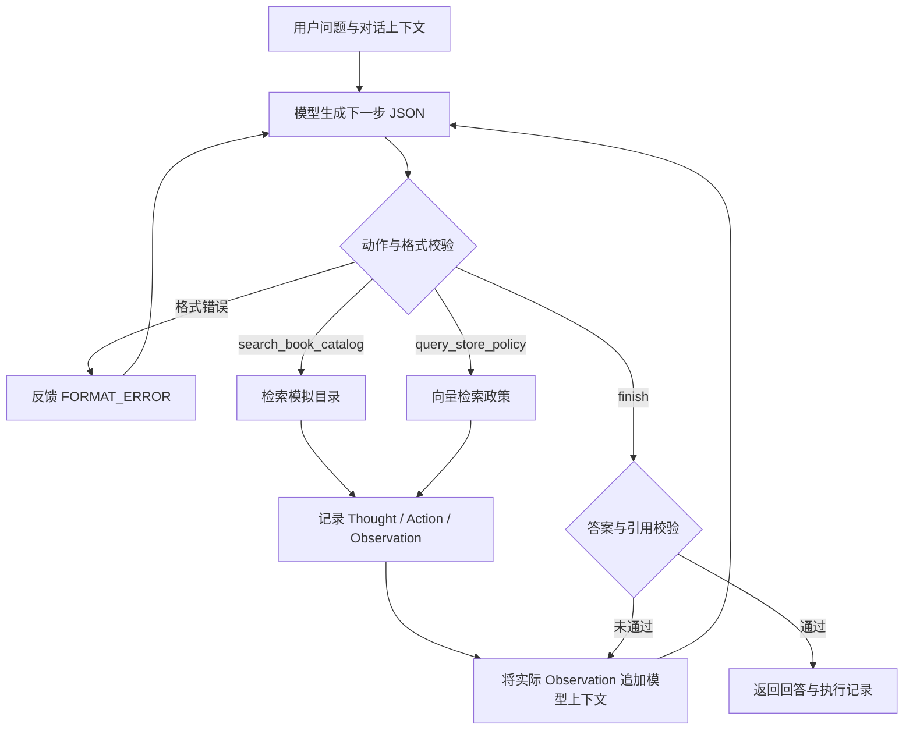

# Task 3 实现过程：政策 RAG 与 ReAct 导购

## 1. 目标与实现范围

本任务让书店导购 Agent 同时处理模糊选书需求与退换货、会员政策问题。案例为：

> 我想买一本关于微服务的书，另外如果我买了不喜欢，拆了塑封还能退吗？

新增独立的 Python 导购服务和 React `/guide` 页面。查书使用模拟目录，政策来自本地文档的向量检索，模型决定下一步行动，应用执行工具。没有修改 Java 业务，也不依赖数据库即可验收。

## 2. 先准备可检索的知识来源

### 政策文档

`data/store_policy.md` 是自编的课程模拟文档，包括 P01–P08 八个章节：未拆封退货、拆封与不喜欢、质量售后、退款渠道、积分、银卡、电子书与特殊商品，以及未覆盖事项。

特意将“拆封后不喜欢”与“缺页等质量问题”分开，避免 Agent 只回答“拆封一律不能退”而遗漏质量售后。会员条款明确不能豁免未拆封要求。

每个片段保留章节编号、标题、来源和正文，以便最终回答引用并人工核对。

### 模拟目录

`data/catalog.json` 中定义六本虚构教学书目，包含微服务入门、微服务进阶、分布式系统、Python、Java 和科幻。图书 ID 使用 SIM 前缀，作者及价格均明确为模拟。不是实际库存接口，也没有冒充真实图书销售数据。

## 3. 文档加载、Chunking 与向量化

实现文件：`rag.py`。

处理链路：

```text
UTF-8 政策文件
→ 按 P01–P08 章节拆分
→ 每章最多 280 字窗口，长章重叠 50 字
→ 中文单字/双字、英文词项特征
→ TF-IDF
→ L2 归一化向量
→ 余弦相似度检索
```

当前文档产生 8 个片段、1045 维向量。章节不足 280 字时不强制重复切片，长章节的重叠窗口行为由测试验证。

向量化采用明确可解释的本地词项 Embedding，不是预训练神经模型。对每个词项：

```text
TF(t,d) = 1 + ln(count(t,d))，未出现则为 0
IDF(t) = ln((1 + 文档片段数) / (1 + 包含该词项的片段数)) + 1
向量分量 = TF × IDF
最后除以向量的 L2 范数
```

查询使用同一个词表和 IDF 生成向量，不能另建一套查询坐标。检索用归一化向量点积计算余弦相似度。

`policy_index.json` 保存词表、IDF、片段、向量、维度及原文 SHA-256，便于直接检查“不是仅把文档拼进 Prompt”。服务从政策原文建立内存索引，单独的构建脚本将相同结果导出为可检查文件。

没有安装新依赖，也没有用 TF-IDF 冒充外部神经 Embedding API。小规模知识库采用线性相似度扫描，无需向量数据库。

## 4. 两个工具

### search_book_catalog(query)

加载模拟目录，将书名、简介和标签向量化后匹配用户需求。对微服务、分布式、Python、Java、科幻等明确主题限制对应候选，避免“入门”之类共用词造成跨主题推荐。支持将 microservices 等常见词映射到中文主题。

结果返回图书、价格、匹配分数及 `simulated=true`。没有足够相关的书目时返回空列表，不编造书名。

### query_store_policy(query)

将问题向量化，与政策片段计算余弦相似度，返回分数最高且不低于 0.12 的至多三个片段。每条结果包含 `id`、`section`、`source`、`text`、`score` 等。

例如“拆了塑封不喜欢还能退吗”最高命中 P02；“银卡会员积分规则”能匹配 P05、P06；“缺页质量问题”最高匹配 P03。

对无关的“量子色动力学”测试，返回空片段。设定最低相关性阈值是为避免把任意最高分都当作有效政策依据；该阈值是当前小知识库的经验值，不能保证覆盖所有同义表达。

## 5. ReAct 循环

实现文件：`agent.py`。



每轮决策使用三个固定字段：

```json
{
  "thought": "先查找与阅读需求相关的模拟书目。",
  "action": "search_book_catalog",
  "action_input": {"query": "微服务 入门"}
}
```

Thought 是公开的简短行动理由，限制为 120 字以内，不读取或展示模型隐藏思维链。Action 是可执行的白名单工具名，Observation 必须由程序执行工具后产生，不能由模型自己伪造为工具执行结果。

模型通过 Chat Completions 兼容 API、JSON 对象输出模式接收决策协议和两个工具的描述。本任务没有使用工具框架自动封装；循环、参数校验、工具派发、反馈和结束逻辑均由代码显式实现。

复合问题按提示先查书、看到结果后查政策，再综合回答。只问会员时不必查书，只推荐图书时不必检索政策。工具选择由模型逐轮决定，不是所有问题无条件固定执行两个工具。

## 6. 可靠性与异常处理

- 工具参数必须是仅含非空 `query` 的对象，限制长度，未知动作不执行。
- 不使用 eval，模型不能执行任意 Python 代码。
- 解析失败时反馈 FORMAT_ERROR，允许模型重新生成 JSON。
- 工具异常作为结构化 Observation 反馈模型。
- 同一动作与相同参数不重复执行，避免无意义循环。
- 最多 7 轮模型决策，每轮最多输出 1600 tokens；达到上限结束请求。
- 最终政策回答需要引用检索到的 ID，未检索到的引用会被拒绝。
- 文档或工具结果被视为数据，不作为新的系统指令。
- 密钥经隐藏输入进入进程环境，不写到前端或提交包。

引用校验能防止引用不存在的片段，但不能自动证明每个自然语言结论都被原文支持。页面显示原始政策片段，便于评阅者核对。

## 7. 前端与日志

`GuidePage.js` 新增对话页，显示模型模式、分块与维度、最终回答和政策引用。每条回答默认展开 ReAct 执行列表，Observation 可展开查看完整 JSON。另提供“查看政策分块与向量信息”。

Python 终端和案例 `.log` 文件按以下标签打印：

```text
Thought: 一句行动理由
Action: 工具名 + 参数
Observation: 实际工具结果
```

浏览器 Console 同时记录每一步。执行列表在本次 Agent 请求完成后一起返回，不是逐 token 或逐步流式推送。

页面继承 Task 2 的健康检查经验：忽略 StrictMode 清理导致的取消，成功后清除旧失败状态，防止迟到失败覆盖成功连接。

## 8. 测试与实际证据

自动测试覆盖文档加载、完整长文重叠分块、向量维度与单位范数、持久化产物、相关性、无关查询、工具参数、工具路由、观察回传、引用纠错、循环上限以及本机 HTTP 服务。

模型协议的本机 HTTP 测试替身与真实模型证据分开标注。真实 API 使用学校提供的 deepseek-chat，目录和政策仍是模拟内容。具体执行结果见 `VALIDATION.md`，原始证据见 `evidence/`，不能把离线决策日志称为真实大模型运行。

## 9. 评分要求对应

| 要求 | 实现与验收入口 |
| --- | --- |
| A：文档加载、切分、Embedding 化 | store_policy.md、rag.py、build_policy_index.py、policy_index.json |
| B：可用的 RAG 检索工具 | query_store_policy，返回片段与相似度；页面可检查来源 |
| C：完整 ReAct 循环 | run_agent 的逐轮决策、执行、观察、纠错、finish 和 7 轮上限 |
| D：根据意图路由 | 复合案例先查书再查政策；政策单问与书目单问的独立测试 |
| E：清晰运行日志 | demo/live 案例日志的 Thought → Action → Observation 链路 |

评分由课程评阅者决定；本文记录具体实现与实际证据，不预先保证评分结果。

## 10. 自测与提交

安装、启动、测试问题和截图建议见 `README.md`。核心命令：

```bash
python3 scripts/build_policy_index.py
python3 scripts/run_guide.py
# 另开终端，复用或启动原前端，访问 /guide
```

无需网页生成案例：

```bash
python3 scripts/run_guide_case.py --live
```

重新打包：

```bash
python3 scripts/package_guide_submission.py
```

提交独立 ZIP，不压缩整个工程或任何第三方 JAR。保留可复现的源码、脚本、文档、向量产物和运行证据。

设计参考：[ReAct 原论文](https://arxiv.org/abs/2210.03629)。本实现用公开简短行动理由记录决策，与模型内部隐藏推理过程分开。
