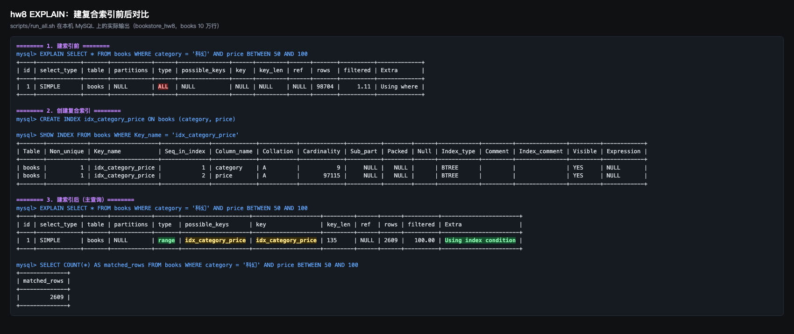

# 作业 8：书店库表设计（反范式）+ 10 万数据 + 复合索引 EXPLAIN 分析

## 0. 目录与运行

```
hw8-mysql/
├── sql/01_schema.sql        # 建库建表 DDL：users / books / orders / order_items
├── sql/02_seed.sql          # 模拟数据：图书 10 万、用户 1 千、订单 1 万（订单详情 2 万）
├── sql/03_index.sql         # 复合索引 idx_category_price (category, price)
├── sql/04_explain.sql       # 全部 EXPLAIN 语句（可直接在 mysql 客户端执行）
├── scripts/run_all.sh       # 一键：建表 → 灌数 → 建索引前 EXPLAIN → 建索引 → EXPLAIN / EXPLAIN ANALYZE → 截图
├── scripts/render_evidence.py
└── evidence/                # 实际输出 explain-output.txt 与截图 *.png
```

```bash
cd hw8-mysql
MYSQL_USER=root MYSQL_PASSWORD=123 ./scripts/run_all.sh   # 只重建独立库 bookstore_hw8，不影响业务库 bookstore
```

环境：MySQL 8.4.9，InnoDB，utf8mb4。灌数约 3 秒（递归 CTE + 一条 `INSERT ... SELECT`）。

另外，业务后端（`backend/`）也同步实现了订单主表的反范式字段，详见第 5 节。

---

## 1. 建表 DDL 要点（评分项 1）

完整语句见 `sql/01_schema.sql`。

| 表 | 主键 | 关键数据类型选择 |
| --- | --- | --- |
| `users` | `id BIGINT UNSIGNED AUTO_INCREMENT` | `password_hash CHAR(60)`（BCrypt 定长）；`role ENUM`；`username`、`email` 唯一索引 |
| `books` | `id BIGINT UNSIGNED AUTO_INCREMENT` | **`price DECIMAL(10,2)`**：金额用定点数，避免浮点误差，同时可以做范围查询和排序；`isbn VARCHAR(17)` 唯一；`publish_date DATE`；`rating DECIMAL(2,1)`；`stock/sales INT UNSIGNED` |
| `orders` | `id BIGINT UNSIGNED AUTO_INCREMENT` | `order_no CHAR(20)` 唯一；`total_amount DECIMAL(10,2)`；`status ENUM`；`book_snapshot JSON`；`(user_id, created_at)` 复合索引 |
| `order_items` | `id BIGINT UNSIGNED AUTO_INCREMENT` | `unit_price/subtotal DECIMAL(10,2)`；`order_id`、`book_id` 均有索引 |

- 主键统一使用自增 `BIGINT`：InnoDB 聚簇索引按主键顺序追加写入，页分裂少；二级索引叶子节点存的主键也短。
- 不建物理外键：高并发 OLTP 场景下，外键会带来额外的加锁和级联检查开销，引用完整性由应用层保证。但所有逻辑外键列（`user_id`、`order_id`、`book_id`）都建了索引。

## 2. 反范式设计（评分项 2）

按第三范式，订单只需要保存 `user_id`；书名、价格等也只需通过 `order_items.book_id` 关联 `books` 获取。本设计有意冗余了下列字段：

| 冗余字段 | 所在表 | 来源 | 业务原因 |
| --- | --- | --- | --- |
| `user_nickname` | `orders` | `users.nickname` | 订单列表和后台订单管理是最高频的读操作。冗余后**不必 JOIN users**；并且它是**下单时刻的快照**，用户之后改昵称不影响历史订单 |
| `item_count` | `orders` | `SUM(order_items.quantity)` | 列表页显示“共 N 件”，不必每次 JOIN + GROUP BY 聚合 |
| `book_snapshot` (JSON) | `orders` | `order_items` + `books` | 列表页直接展示封面、书名、单价、数量，**一次单表查询即可渲染整页订单卡片**，不再 JOIN `order_items` 和 `books` |
| `book_title / book_author / book_isbn / cover_img / unit_price` | `order_items` | `books` | **历史快照**：图书改价、改名或下架后，历史订单和发票必须保持成交时的信息。这既是性能需求，也是业务正确性需求 |

**空间换时间的代价与取舍：**
- 空间：每个订单多出约 64B 昵称和约 200B 的 JSON，对 1 万订单约 2.6MB。与磁盘成本相比可以忽略。
- 写入：只在下单这一次写入，且与主表同一个事务内完成，几乎没有额外开销。订单是“写一次、读很多次”的数据，非常适合反范式。
- 一致性：这些字段本来就**应该**是下单时的快照，不需要与 `users`/`books` 实时同步，所以不存在“更新异常”的问题。

**效果（`evidence/04-denormalization.png`）：**

| 写法 | EXPLAIN |
| --- | --- |
| 范式化：`orders JOIN users JOIN order_items ... GROUP BY o.id ORDER BY created_at` | 3 张表，并出现 **`Using temporary; Using filesort`**（需要临时表分组、额外排序） |
| 反范式：`SELECT ... FROM orders WHERE user_id=42 ORDER BY created_at DESC LIMIT 10` | 单表，`type=ref`，`key=idx_orders_user_created`，`Extra=Backward index scan`：反向扫描索引即为有序结果，**无临时表、无 filesort** |

## 3. 10 万数据与复合索引（评分项 3）

`sql/02_seed.sql` 用递归 CTE 生成 100,000 本书：
- 10 个类别，每类正好 10,000 本。
- 价格在 10.00 ~ 200.00 之间均匀分布，由 `RAND(n)` 按种子生成，可复现。

```sql
CREATE INDEX idx_category_price ON books (category, price);
```

**列顺序的理由：** `category` 是等值条件，放第 1 列；`price` 是范围条件和排序列，放第 2 列。在 `category` 相同的前提下，索引按 `price` 有序，所以 `category = ? AND price BETWEEN ? AND ?` 可以在 B+ 树上定位到一段**连续**区间。反过来，如果写成 `(price, category)`，范围列在前，后面的 `category` 就无法再用来缩小扫描范围。

`SHOW INDEX` 结果：`category` 的基数为 9（真实值为 10，是统计估算）；`(category, price)` 的组合基数约 9.7 万，接近唯一，区分度高。

## 4. EXPLAIN 截图与解读（评分项 4、5）

测试查询（“科幻”类、价格 50~100，实际命中 2,609 行）：

```sql
SELECT * FROM books WHERE category = '科幻' AND price BETWEEN 50 AND 100;
```

截图：
- `evidence/01-explain-before-after.png`：建索引前后对比（主截图）
- `evidence/02-explain-covering-order-leftmost.png`：覆盖索引、排序分页、最左前缀反例
- `evidence/03-explain-analyze.png`：实际耗时
- `evidence/04-denormalization.png`：反范式对比
- 完整原始输出：`evidence/explain-output.txt`



### 4.1 建索引前后对比

| 列 | 建索引前 | 建索引后 | 含义 |
| --- | --- | --- | --- |
| **type** | `ALL` | **`range`** | `ALL` 是全表扫描，在聚簇索引上逐行读取约 10 万行。`range` 是索引范围扫描，只扫描 B+ 树中 `('科幻', 50.00)` 到 `('科幻', 100.00)` 这一段。访问类型从最差的 ALL 提升到 range |
| possible_keys | `NULL` | `idx_category_price` | 优化器认为可用的索引 |
| **key** | `NULL` | **`idx_category_price`** | 优化器**实际选用**的索引。非 NULL，说明**索引生效** |
| key_len | `NULL` | `135` | 实际使用的索引字节数：`category VARCHAR(32)` 为 32×4（utf8mb4）+ 2（变长长度）= 130，`price DECIMAL(10,2)` 为 5，合计 **135**。说明**两列都参与了范围定位**，而不只是用到了第 1 列 |
| rows | `98,704` | **`2,609`** | 预估扫描行数。下降约 38 倍，且与实际命中行数 2,609 一致 |
| filtered | `1.11` | `100.00` | 存储引擎返回的行中，满足其余 WHERE 条件的比例。100% 表示索引已经精确过滤，Server 层不必丢弃任何行 |
| **Extra** | `Using where` | **`Using index condition`** | 见下文 |

**`Using index condition`（索引条件下推，ICP）**：WHERE 条件被下推到 InnoDB 存储引擎层，先用二级索引里的 `(category, price)` 判断是否满足条件，满足的才**回表**（按主键到聚簇索引读整行）。不满足的行无需回表，从而减少回表次数。因为是 `SELECT *`，二级索引里没有其他列，所以必须回表，Extra 不会出现 `Using index`。

建索引前的 `Using where` 表示：存储引擎把全部 10 万行逐行返回给 Server 层，再由 Server 层用 WHERE 过滤，最终只保留 1.11%。

### 4.2 覆盖索引：`Using where; Using index`

```sql
EXPLAIN SELECT id, category, price FROM books WHERE category='科幻' AND price BETWEEN 50 AND 100;
```

- `type=range`，`key=idx_category_price`，**`Extra=Using where; Using index`**。
- **`Using index`** 表示覆盖索引：查询需要的列都在索引里（InnoDB 二级索引叶子节点天然包含主键 `id`），所以**完全不回表**，只读索引页，是最高效的情况。
- 由此得到的优化建议：列表页只查 `id/category/price` 等少数列，详情页再按主键查整行，即“延迟关联”的思路。

### 4.3 排序分页：无 `Using filesort`

`... ORDER BY price LIMIT 20` 的 Extra 仍然只有 `Using index condition`，**没有 `Using filesort`**。原因是在 `category` 固定的前提下，索引已经按 `price` 有序，按索引顺序读到 20 行就可以停止，不需要额外排序。

### 4.4 反例：违反最左前缀，索引失效

`WHERE price BETWEEN 50 AND 100`（不带 `category`）的结果是 `type=ALL`，`key=NULL`，`rows≈98,841`。
复合索引先按 `category` 排序，`price` 只在同一个 `category` 内部有序；跳过第 1 列后，`price` 在整棵树上并不连续，无法定位范围，只能全表扫描。

### 4.5 EXPLAIN ANALYZE 实际执行

| 计划 | 实际耗时 | 实际扫描行数 |
| --- | --- | --- |
| `Index range scan on books using idx_category_price ... with index condition` | **约 9 ms** | 2,609 |
| `IGNORE INDEX` → `Table scan on books` + `Filter` | **约 75 ms** | 100,000 |

结论：**索引生效**。type 从 ALL 变为 range，key 命中 `idx_category_price`，key_len=135 说明两列都被使用，Extra 出现 `Using index condition`（覆盖查询时为 `Using index`）。扫描行数从 10 万降到 2,609，实际耗时降低约 8 倍。

## 5. 后端代码同步改造（订单主表反范式落地）

| 文件 | 改动 |
| --- | --- |
| `backend/src/main/java/com/bookstore/entity/Order.java` | 新增 `userNickname`、`itemCount`、`bookSnapshot`（`json` 列） |
| `backend/src/main/java/com/bookstore/service/impl/OrderServiceImpl.java` | 下单时在同一事务中写入：昵称（为空则取用户名）、件数合计、图书快照 JSON |
| `backend/src/main/java/com/bookstore/dto/OrderDto.java` | 对外返回上述字段，`bookSnapshot` 用 `@JsonRawValue` 原样输出为 JSON 数组 |
| `backend/src/main/resources/schema.sql` | `orders` 表新增三列（已有库由 Hibernate `ddl-auto=update` 自动加列） |
| `backend/src/test/.../OrderServiceImplTest.java` | 新增用例：断言冗余的昵称、件数、快照 JSON |

真实下单后的数据库记录见 `evidence/app-order-denormalized.txt`：

```
user_nickname: 反范式测试员
   item_count: 3
book_snapshot: [{"qty": 1, "cover": "/images/to-live.jpg", "price": 3.0, "title": "活着", "bookId": 3},
                {"qty": 2, "cover": "/images/sapiens.jpg", "price": 68.0, "title": "人类简史：从动物到上帝", "bookId": 2}]
```
